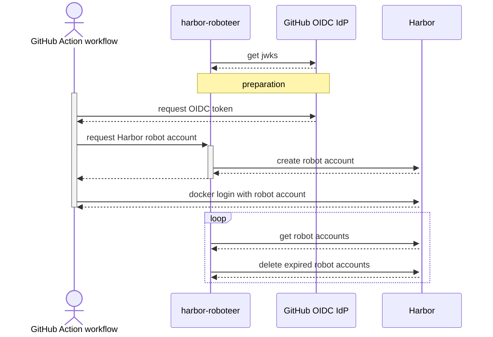

# harbor-roboteer

Service to run next to Harbor to map OIDC to robot accounts

## Endpoints

### `POST /token`

Create a new Harbor `robot$...` account based on the JWT.

```bash
curl -X POST https://harbor-roboteer.example.com/token \
  -H "Authorization: Bearer $ACTIONS_ID_TOKEN_REQUEST_TOKEN"
```

Response `200 OK`:

```json
{
  "robot": {
    "username": "robot$github-actions+my-repo",
    "password": "..."
  },
  "deleteToken": "..."
}
```

### `DELETE /token`

Clean up robot account at the end of workflow.

```bash
curl -X DELETE https://harbor-roboteer.example.com/token \
  --url-query username='robot$github-actions+my-repo' \
  -H "Authorization: Token $DELETE_TOKEN"
```

Response `201 Created`

## How it works


