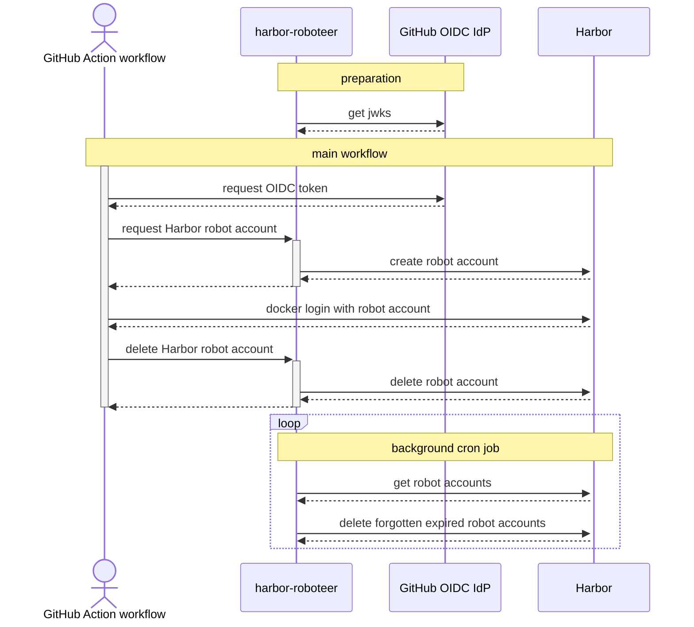

# harbor-roboteer

Service to run next to Harbor to map OIDC to robot accounts.

Harbor supports OIDC, but only via web login flow (see <https://github.com/goharbor/community/issues/302>).
Meaning that if you want services to access Harbor, then you can't use OIDC.
Harbor does not support OAuth2.0 Token Exchange
(aka "workload identity federation"), so the solution is to use
Harbor robot accounts.

This project dynamically creates Harbor robot accounts based on valid OIDC JWTs.
Process is then:

1. You get your service OIDC token (from GitHub OIDC, Keycloak, etc)
2. Send the token over to `harbor-roboteer`
3. `harbor-roboteer` creates a short-lived Harbor robot account for the JWT
4. You use the robot account's credentials when doing `docker pull/push`

## Install

Run the `harbor-roboteer` server next to your Harbor.
Recommended to use our Helm chart.

### Helm

See [./helm/harbor-roboteer](./helm/harbor-roboteer/README.md)

Chart is available on GitHub Container Registry: <https://github.com/RiskIdent/harbor-roboteer/pkgs/container/charts%2Fharbor-roboteer>

```bash
# must specify required flags in values.yaml, such as oidc-issuer, harbor-url, etc

helm install harbor-roboteer oci://ghcr.io/riskident/charts/harbor-roboteer \
  --version 1.0.0 \
  -f values.yaml \
  --set-file config=roboteer.jsonnet
```

### Docker

Image is available on GitHub Container Registry: <https://github.com/RiskIdent/harbor-roboteer/pkgs/container/harbor-roboteer>

```bash
docker run ghcr.io/riskident/harbor-roboteer:latest serve --help
```

### Binaries

Binaries are also available via GitHub releases: <https://github.com/RiskIdent/harbor-roboteer/releases>

You can use tools like [mise](https://mise.jdx.dev/) to install it:

```bash
mise x github:RiskIdent/harbor-roboteer@latest -- harbor-roboteer serve --help
```

Attestations exist for the binaries, zip files, and tarballs: <https://github.com/RiskIdent/harbor-roboteer/attestations>

## Config

The config maps claims from a validated OIDC token to Harbor permissions. It is
a [Jsonnet](https://jsonnet.org/) file that evaluates to a
`function(claims)` and returns a list of permission objects. Pass the file with
`--config` (or `$ROBOTEER_CONFIG`). Returning an empty list rejects the token.

See [./roboteer.jsonnet](./roboteer.jsonnet) for a full example.

Each permission has a `kind` (`project` or `system`) and an `access` object that
maps Harbor resources to actions.

- For project permissions, set `kind: 'project'`,
  and set `namespace` to the Harbor project name or `*` for all projects.

- For system permissions, set `kind: 'system'`,
  and either omit `namespace` or set it to `/`.

- `null` permission entries are ignored, and can be used to conditionally
  grant access. In Jsonnet, `if someCondition then {...}` is the same as
  `if someCondition then {...} else null`

<details><summary>Deny everything</summary>

```jsonnet
function(claims) [
  // returns no permissions => no access granted => means "reject all JWTs"
]
```

</details>

<details><summary>Grant unconditional pull access to one project</summary>

```jsonnet
function(claims) [
  // Does not make use of 'claims' at all, so every JWT gets access to 'acme-shared'
  {
    kind: 'project',
    namespace: 'acme-shared',
    access: {
      repository: ['list', 'read', 'pull'],
      artifact: ['list', 'read'],
    },
  },
]
```

</details>

<details><summary>Grant pull access to project depending on token claim</summary>

```jsonnet
function(claims)
  // Referring to GitHub OIDC claims.
  // Look at documentation from your OIDC issuer for which claims are available.
  local owner = std.get(claims, 'repository_owner');
  local repository = std.get(claims, 'repository', '');

  [
    // Only some JWTs get access to `acme-shared`
    if owner == 'acme' && repository != '' then {
      kind: 'project',
      namespace: 'acme-shared',
      access: {
        repository: ['list', 'read', 'pull'],
        artifact: ['list', 'read'],
      },
    },
  ]
```

</details>

<details><summary>Grant conditional push access</summary>

```jsonnet
// you can define your own functions
local projectPermission(name, access) = {
  kind: 'project',
  namespace: name,
  access: access,
};

// or define custom data structures with for example your own concept of "roles"
local roles = {
  pull: {
    repository: ['list', 'read', 'pull'],
    artifact: ['list', 'read'],
  },
  push: self.pull {
    // the "+" syntax means we extend the 'pull' lists instead of replacing them
    repository+: ['push'],
    artifact+: ['create'],
  },
};

function(claims)
  local owner = std.get(claims, 'repository_owner');
  local repository = std.get(claims, 'repository', '');
  local environment = std.get(claims, 'environment');

  [
    if owner == 'acme' && repository != '' then projectPermission('acme-shared', roles.pull),
    if owner == 'acme' && repository != '' && environment == 'harbor' then
      projectPermission('acme-shared', roles.push),
  ]
```

</details>

<details><summary>Grant shared, all-project, and system permissions by identity</summary>

```jsonnet
// Helpers to build the permission objects.
local lib = {
  // Permissions on one Harbor project.
  project(name, access):: { kind: 'project', namespace: name, access: access },
  // Permissions on all projects, including ones created later ("Cover all projects" in Harbor).
  allProjects(access):: self.project('*', access),
  // System-level permissions.
  system(access):: { kind: 'system', namespace: '/', access: access },
};

local roles = {
  pull: {
    repository: ['list', 'read', 'pull'],
    artifact: ['list', 'read'],
  },
  projectCreator: {
    project: ['create'],
    label: ['create', 'update'],
  },
};

function(claims)
  local owner = std.get(claims, 'repository_owner');
  local repository = std.get(claims, 'repository', '');

  [
    if owner == 'acme' then
      lib.project('acme-shared', roles.pull),
    if owner == 'acme' && repository == 'acme/image-scanner' then
      lib.allProjects(roles.pull),
    if owner == 'acme' && repository == 'acme/harbor-bootstrap' then
      lib.system(roles.projectCreator),
  ]
```

</details>

<details><summary>Grant dynamic access based on claims</summary>

```jsonnet
// Helpers to build the permission objects.
local lib = {
  // Permissions on one Harbor project.
  project(name, access):: { kind: 'project', namespace: name, access: access },
  // Permissions on all projects, including ones created later ("Cover all projects" in Harbor).
  allProjects(access):: self.project('*', access),
  // System-level permissions.
  system(access):: { kind: 'system', namespace: '/', access: access },
};

local roles = {
  pull: {
    repository: ['list', 'read', 'pull'],
    artifact: ['list', 'read'],
  },
  push: self.pull {
    // the "+" syntax means we extend the 'pull' lists instead of replacing them
    repository+: ['push'],
    artifact+: ['create'],
  },
};

function(claims)
  local owner = std.get(claims, 'repository_owner');
  local repository = std.get(claims, 'repository', '');
  local environment = std.get(claims, 'environment');
  local harborProject = std.asciiLower(std.strReplace(repository, '/', '-'));

  if owner == 'acme' && repository != '' then [
    // with 'repository: acme/ImageScanner' in claim, grant access to 'acme-imagescanner' project
    lib.project(harborProject, roles.pull),
    // conditionally grant push access if using GitHub environment
    if environment == 'harbor' then lib.project(harborProject, roles.push),
  ]
```

</details>

<details><summary>Grant deeply nested permissions from owner and repository claims</summary>

```jsonnet
// Helpers to build the permission objects.
local lib = {
  // Permissions on one Harbor project.
  project(name, access):: { kind: 'project', namespace: name, access: access },
  // Permissions on all projects, including ones created later ("Cover all projects" in Harbor).
  allProjects(access):: self.project('*', access),
  // System-level permissions.
  system(access):: { kind: 'system', namespace: '/', access: access },
};

local roles = {
  pull: {
    repository: ['list', 'read', 'pull'],
    artifact: ['list', 'read'],
  },
  push: self.pull {
    repository+: ['push'],
    artifact+: ['create'],
  },
};

function(claims)
  local owner = std.get(claims, 'repository_owner');
  local repository = std.get(claims, 'repository', '');
  local repositoryParts = std.split(repository, '/');
  // For "acme/image-api", this becomes "image-api".
  local repositoryName = repositoryParts[std.length(repositoryParts) - 1];
  local environment = std.get(claims, 'environment');

  // with flattening, you can define a tree of permission grants
  std.flattenDeepArray([
    if owner == 'acme' && repository != '' then [
      lib.project(repositoryName, roles.pull),

      if repositoryName == 'image-api' then [
        lib.project('acme-shared', roles.pull),

        if environment == 'harbor' then
          lib.project(repositoryName, roles.push),
      ],
    ],

    if owner == 'platform' && repository != '' then [
      lib.project('platform-' + repositoryName, roles.pull),
    ],
  ])
```

</details>

See <https://jsonnet.org/ref/stdlib.html> for list of Jsonnet utility
functions available.

## Usage

### Usage from GitHub

Use our GitHub Action: <https://github.com/RiskIdent/harbor-roboteer-action>

```yaml
on:
  pull_request:
  push:
    tags:
      - "v*"

jobs:
  docker-pull:
    runs-on: ubuntu-latest

    permissions:
      id-token: write # This is required for requesting the JWT

    # use 'harbor' env when building and pushing a new release
    environment: ${{ github.event_name == 'push' && startsWith(github.ref, 'refs/tags/') && 'harbor' || '' }}

    steps:
      - name: Login to Harbor
        uses: RiskIdent/harbor-roboteer-action@v1
        with:
          harbor-url: https://harbor.example.com
          setup-docker-auth: true

      - name: Try pull image
        run: |
          docker pull harbor.example.com/foo/bar
```

For additional hardening: configure harbor-roboteer to only grant push access
when using a GitHub environment, and then configure that environment to only
be allowed to be used from certain branches/tags.
Such as limiting the `harbor` environment used above to
"Selected branches and tags" in the environment settings,
and add a filter for `v*` tags.

### Using roboteer's API manually

Configure `harbor-roboteer` to trust your OIDC issuer via the
`--oidc-issuer` flag or `ROBOTEER_OIDC_ISSUER` environment variable. Repeat
the flag or use comma-separated environment variable values to support multiple
issuers. E.g:

```console
--oidc-issuer=https://token.actions.githubusercontent.com \
--oidc-issuer=https://kubernetes.example.com
```

Request an OIDC token whose `aud` includes `harbor-roboteer` (the default).
If you use a different audience, configure the server to match it via
`--oidc-audience` or `ROBOTEER_OIDC_AUDIENCE`.

Then when you have an OIDC token, send it to the `POST /api/roboteer/v1/robot`
endpoint.

```bash
JWT=... # e.g obtained from GitHub OIDC, Keycloak, etc

ROBOTEER_URL=https://harbor.example.com/api/roboteer/v1/robot
ROBOTEER_RESPONSE="$(curl -sS --fail-with-body "$ROBOTEER_URL" -X POST --oauth2-bearer "$JWT" --data '{}')"

ROBOT_ID=$(jq -r .robot.id <<< "$ROBOTEER_RESPONSE")
ROBOT_USERNAME=$(jq -r .robot.username <<< "$ROBOTEER_RESPONSE")
ROBOT_PASSWORD=$(jq -r .robot.password <<< "$ROBOTEER_RESPONSE")
DELETE_TOKEN=$(jq -r .deleteToken <<< "$ROBOTEER_RESPONSE")
```

When you're done with the account, send the robot ID and delete token
(which you get from the `POST` response) to the `DELETE /api/roboteer/v1/robot`
endpoint.

```bash
curl -sS --fail-with-body "$ROBOTEER_URL?robot_id=$ROBOT_ID" -X DELETE --oauth2-bearer "$DELETE_TOKEN"
```

Endpoint docs: <https://riskident.github.io/harbor-roboteer/>
(which is generated from [`docs/openapi.yaml`](docs/openapi.yaml))

### Cleanup

Cleanup is an optional, but highly recommended, feature of harbor-roboteer.
Run it with `harbor-roboteer cleanup` subcommand.

> Aside: in [the Helm chart](./helm/harbor-roboteer/README.md) we install
> a CronJob that triggers the `harbor-roboteer cleanup` subcommand for you.

This task will delete robot accounts from Harbor that are past their expiry.

Harbor robot accounts already have a concept of "expiry",
but it has some drawbacks:

- Harbor's expiry only works on a per-24h unit.
  You cannot set expiry to "in 30min", for example.

- After expiry, the robot account still exists, but marked as "expired".
  Over time these expired robot accounts will bloat the UI.

For this reason we've implemented our own expiry feature on top of Harbor's.
The harbor-roboteer expiry time (controlled by the `--robot-ttl` flag) is
enforced by the cleanup task.

## How it works



## Security considerations

1. If you grant access to create or manage robot accounts, then the user could
   use the ephemeral robot account to create a hidden persistent robot account.
   In harbor-roboteer we only grant the permissions that the config file
   specifies, but we do not protect against misconfigurations like this.

2. Config is not automatically reloaded. Make sure harbor-roboteer is restarted
   after you have changed the config to not have stale authorization.

## Development

### mise

Mise (aka "mise-en-place") is used to manage tooling to make sure we have the
same version of everything.

Recommended to set up automatic activation:

```bash
# for bash
echo 'eval "$(mise activate bash)"' >> ~/.bashrc
# for zsh
echo 'eval "$(mise activate zsh)"' >> ~/.zshrc
# for fish
echo 'mise activate fish | source' >> ~/.config/fish/config.fish
```

### pre-commit via hk

Recommended to use our pre-commit hooks, provided via [hk](https://hk.jdx.dev/)

```bash
# if using Git 2.54+ (check with "git --version"), then it's recommended to install globally
mise run pre-commit:install:global

# otherwise:
mise run pre-commit:install
```

### API docs

OpenAPI spec in [`docs/openapi.yaml`](docs/openapi.yaml) is hand-written.
Nothing is generated from it.
It is only used by [Redoc](https://github.com/Redocly/redoc) in GitHub Pages
at <https://riskident.github.io/harbor-roboteer/>.

```bash
npm install
npm run docs:serve
```

The `version` in the spec is bumped by release-please, via the
`x-release-please-version` comment.

## Prior art

| Link | Purpose | Comparison
| --- | --- | ---
| <https://github.com/dvob/hati> | Same as this project. Create robot accounts from JWTs. | Missing robot account cleanup, leading to build up of expired robot accounts.
| <https://github.com/corelyr-oss/vault-plugin-secrets-harbor> | HashiCorp Vault/OpenBao plugin to dynamically create robot accounts | Requires HashiCorp Vault or OpenBao
| <https://github.com/clique-it-tech/vault-plugin-secrets-harbor> | HashiCorp Vault/OpenBao plugin to dynamically create robot accounts | Requires HashiCorp Vault or OpenBao
| <https://github.com/AetherizeGmbH/harbor-workload-identity-bridge> | Kubelet credential provider plugin to replace need for `imagePullSecrets` in Kubernetes | Different use-case
| <https://github.com/gawsoftpl/credential-provider-kubernetes> | Kubelet credential provider plugin, but only the kubelet side. Expects a broker endpoint | Different use-case
| <https://container-registry.com/posts/keyless-harbor-workload-identity-federation/> | 8gears' blog post about their commercial feature in 8gcr. Map JWTs to existing robot accounts, inside the `docker login` flow and as a kubelet credential provider | Proprietary
| <https://github.com/goharbor/harbor/pull/24251> | Attempt by us (RISK IDENT) to upstream OIDC onboarding support | No interactions from Harbor maintainers, unlikely that it'll ever be merged, so we opted for creating this project instead to unblock ourselves.
| <https://github.com/goharbor/harbor/pull/23936> | Attempt by someone else to upstream OIDC onboarding support | No interactions from Harbor maintainers, unlikely that it'll ever be merged.
| <https://github.com/goharbor/community/pull/275> | Proposal to support JWTs as an alternative to robot account's static passwords | Only allows created robot accounts the alternative authentication scheme, but doesn't granting dynamic access. However, [8gcr's stance](https://github.com/goharbor/community/pull/275#pullrequestreview-4119353749) is that they won't help see this proposal through. Unclear if there's even any other Harbor maintainers that can help approve this proposal.
