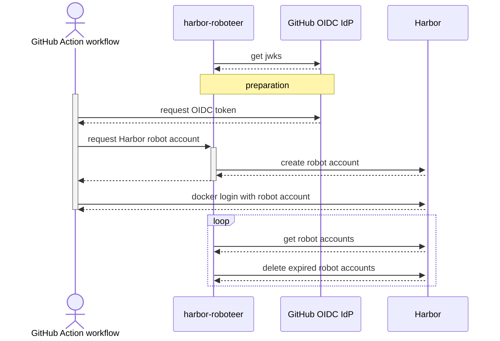

# harbor-roboteer
Service to run next to Harbor to map OIDC to robot accounts

## Endpoints

### `POST /token`

- Authorization: `Bearer {jwt}` header
- Request body: _none_
- Response: `200 OK`
- Response body:

```json
{
  "robot": {
    "username": "...",
    "password": "..."
  },
  "deleteToken": "..."
}
```

### `DELETE /token/:username`

- Authorization: `Token {deleteToken}` header
- Request body: _none_
- Response: `201 Created`
- Response body: _none_

## How it works


