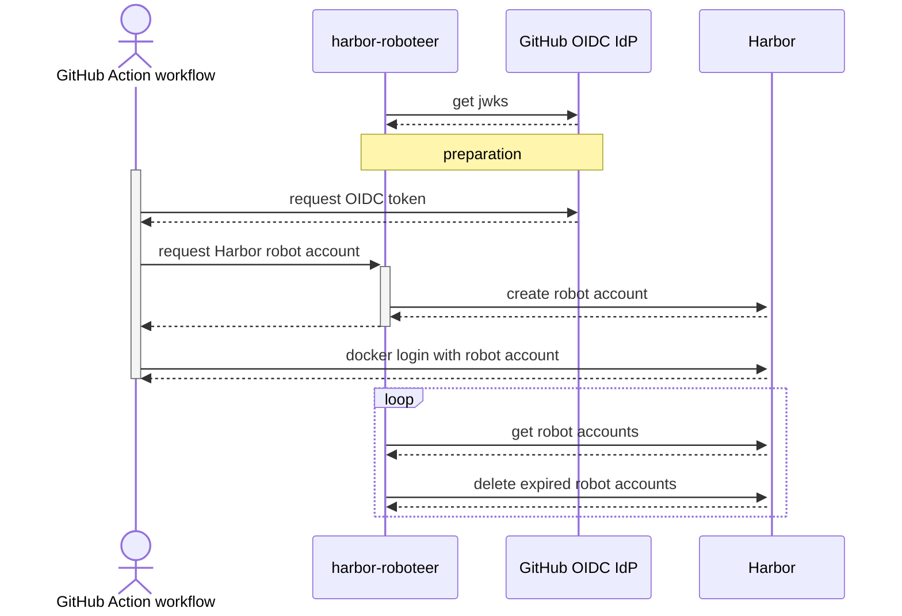

# harbor-roboteer

Service to run next to Harbor to map OIDC to robot accounts

## Endpoints

See <https://riskident.github.io/harbor-roboteer/>, which is generated from
[`docs/openapi.yaml`](docs/openapi.yaml).

## How it works



## Development

### mise

Mise (aka "mise-en-place") is used to manage tooling to make sure we have the
same version of everything.

Recommended to set up automatic activation:

```bash
# for bash
echo 'eval "$(mise activate bash)"' >> ~/.bashrc
# for zsh
echo 'eval "$(mise activate zsh)"' >> ~/.zshrc
# for fish
echo 'mise activate fish | source' >> ~/.config/fish/config.fish
```

### pre-commit via hk

Recommended to use our pre-commit hooks, provided via [hk](https://hk.jdx.dev/)

```bash
# if using Git 2.54+ (check with "git --version"), then it's recommended to install globally
mise run pre-commit:install:global

# otherwise:
mise run pre-commit:install
```

### API docs

OpenAPI spec in [`docs/openapi.yaml`](docs/openapi.yaml) is hand-written.
Nothing is generated from it.
It is only used by [Redoc](https://github.com/Redocly/redoc) in GitHub Pages
at <https://riskident.github.io/harbor-roboteer/>.

```bash
npm install
npm run docs:serve
```

The `version` in the spec is bumped by release-please, via the
`x-release-please-version` comment.

## Prior art

| Link | Purpose | Comparison
| --- | --- | ---
| <https://github.com/dvob/hati> | Same as this project. Create robot accounts from JWTs. | Missing robot account cleanup, leading to build up of expired robot accounts.
| <https://github.com/corelyr-oss/vault-plugin-secrets-harbor> | HashiCorp Vault/OpenBao plugin to dynamically create robot accounts | Requires HashiCorp Vault or OpenBao
| <https://github.com/clique-it-tech/vault-plugin-secrets-harbor> | HashiCorp Vault/OpenBao plugin to dynamically create robot accounts | Requires HashiCorp Vault or OpenBao
| <https://github.com/AetherizeGmbH/harbor-workload-identity-bridge> | Kubelet credential provider plugin to replace need for `imagePullSecrets` in Kubernetes | Different use-case
| <https://github.com/gawsoftpl/credential-provider-kubernetes> | Kubelet credential provider plugin, but only the kubelet side. Expects a broker endpoint | Different use-case
| <https://container-registry.com/posts/keyless-harbor-workload-identity-federation/> | 8gears' blog post about their commercial feature in 8gcr. Map JWTs to existing robot accounts, inside the `docker login` flow and as a kubelet credential provider | Proprietary
