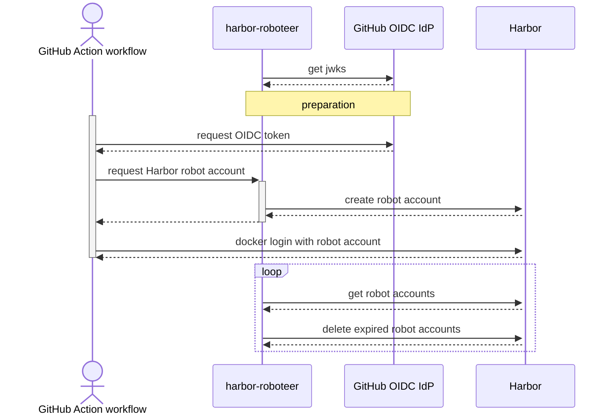

# harbor-roboteer

Create short-lived Harbor robot accounts for OIDC-authenticated workloads.

## Endpoints

See the [API documentation](https://riskident.github.io/harbor-roboteer/),
generated from [`docs/openapi.yaml`](docs/openapi.yaml).

## How it works



## Development

### mise

Mise manages the tool versions used by this project.

Recommended to set up automatic activation:

```bash
# for bash
echo 'eval "$(mise activate bash)"' >> ~/.bashrc
# for zsh
echo 'eval "$(mise activate zsh)"' >> ~/.zshrc
# for fish
echo 'mise activate fish | source' >> ~/.config/fish/config.fish
```

### pre-commit via hk

Run the pre-commit hooks with [hk](https://hk.jdx.dev/):

```bash
# if using Git 2.54+ (check with "git --version"), then it's recommended to install globally
mise run pre-commit:install:global

# otherwise:
mise run pre-commit:install
```

### API docs

The hand-written [`docs/openapi.yaml`](docs/openapi.yaml) is rendered with
[Redoc](https://github.com/Redocly/redoc) and published to
<https://riskident.github.io/harbor-roboteer/>.

```bash
npm install
npm run docs:serve
```

The `version` in the spec is bumped by release-please, via the
`x-release-please-version` comment.

## Prior art

| Link | Purpose | Comparison
| --- | --- | ---
| <https://github.com/dvob/hati> | Create robot accounts from JWTs. | Does not clean up expired robot accounts.
| <https://github.com/corelyr-oss/vault-plugin-secrets-harbor> | HashiCorp Vault/OpenBao plugin to dynamically create robot accounts | Requires HashiCorp Vault or OpenBao
| <https://github.com/clique-it-tech/vault-plugin-secrets-harbor> | HashiCorp Vault/OpenBao plugin to dynamically create robot accounts | Requires HashiCorp Vault or OpenBao
| <https://github.com/AetherizeGmbH/harbor-workload-identity-bridge> | Kubernetes kubelet credential provider; replaces image pull secrets. | Different use-case
| <https://github.com/gawsoftpl/credential-provider-kubernetes> | Kubernetes kubelet-side credential provider; requires a broker endpoint. | Different use-case
| <https://container-registry.com/posts/keyless-harbor-workload-identity-federation/> | Commercial Harbor workload-identity federation; maps JWTs to existing robot accounts. | Proprietary
